# Stonechat

Privacy-first messaging app where **every user runs their own relay**.

- No central message store. Your "relay" is a mailbox of your own, a container
  on a server that hosts a handful of people, a whole VM if you want one, or
  something you run yourself at home. Its only job is to hold **end-to-end
  encrypted envelopes** until your phone picks them up, then delete them.
- No phone number, no email. Your identity is an Ed25519 keypair generated on
  device; your **Stonechat ID** (`SC-XXXX-…`) is a hash commitment to the public key.
  Share it by QR or text — it reveals nothing about you.
- **Forward secrecy, post-quantum hybrid**: PQXDH (X3DH + ML-KEM-768) +
  double ratchet (Signal-style), with prekeys served by your own relay
  instead of a central server. Every message gets a fresh key; stealing keys
  today can't decrypt traffic recorded yesterday, and recording traffic
  today doesn't let a future quantum computer decrypt it
  (docs/POST_QUANTUM.md).
- **Pinned TLS, no CAs**: relays self-sign their certificates; clients pin a
  fingerprint the owner signs with their identity key and publishes in the
  directory. Trust chains to the Stonechat ID, not to any authority — same as
  everything else in the protocol.
- Message history lives on your phone only. Uninstall the app and it's gone. Well, you can do an encrypted backup if you want, but you need to take care of that backup.

See [PROTOCOL.md](PROTOCOL.md) for the full wire protocol.

## How a message travels

<p align="center">
  <picture>
    <source media="(prefers-color-scheme: dark)" srcset="docs/img/how-a-message-travels-dark.svg">
    
  </picture>
</p>

1. **Lookup.** Alice adds Bob by his Stonechat ID; her phone asks the hub where that ID lives.
2. **Answer.** The hub replies with Bob's public key and mailbox address. Alice checks it against the ID she asked for.
3. **Send.** Alice's phone seals the message for Bob and delivers it directly to his mailbox. The hub never sees it.
4. **Retrieve.** Bob's phone fetches the envelope, decrypts it and acks; the mailbox deletes it.

## Components

| Directory       | What it is                                                                                                                                                                                                                                                                                                                      |
| --------------- | ------------------------------------------------------------------------------------------------------------------------------------------------------------------------------------------------------------------------------------------------------------------------------------------------------------------------------- |
| `app/`          | Flutter app (iOS/Android). Keys, history, encryption — all client-side.                                                                                                                                                                                                                                                         |
| `relay/`        | The mailbox. Rust + SQLite; a static binary that runs on the user's VM. Stores ciphertext only, deletes on ack.                                                                                                                                                                                                                 |
| `hub/`          | Provisioner + directory. Boots/destroys relays via a pluggable provider layer and maps Stonechat IDs to pubkeys + current relay address. Never sees message content.                                                                                                                                                            |
| `push_gateway/` | Push gateway for mobile push notifications. Stateless. The only holder of APNs/FCM credentials. Mailboxes ping it when the owner is offline; it sends a content-free wake-up. Sees device tokens + timing, never identities.                                                                                                    |
| `mailbox_host/` | Mailbox host, hosts multiple mailboxes. Runs on a user-owned VM; mints invites and provisions invited friends' mailboxes as containers on that server. If you want to host mailboxes, for friends or family, in your own machine, you should use this. Still connects to the main Stonechat directory (where all the users are) |
| `agent_client/` | Agent client. A headless **device** on a user's identity — links like a phone or a browser tab, holds no identity secret, runs unattended on a server.                                                                                                                                                                          |

## Self-hosting

Everything server-side runs on your own machine. Self-hosting a mailbox or a
mailbox host keeps you on the main Stonechat network; your own hub is a
separate network. Full guide: [docs/SELF-HOST.md](docs/SELF-HOST.md).

### Mailbox

One mailbox. Needs a Linux server with a public IP or DNS name, and
inbound 8080/tcp, 8443/udp and 3478–3479/udp open.

```bash
docker run -d --name stonechat-mailbox --restart unless-stopped \
  -p 8080:8080 -p 8443:8443/udp -p 3478-3479:3478-3479/udp \
  -v stonechat-mailbox:/data \
  -e STONECHAT_OWNER_ID=SC-XXXX-... \
  -e STONECHAT_OWNER_TOKEN=$(openssl rand -hex 24) \
  -e STONECHAT_WT_ADVERTISE=<public IP or DNS name> \
  ghcr.io/stonechat-app/relay:0.3.1
docker inspect stonechat-mailbox | grep STONECHAT_OWNER_TOKEN   # the token
```

`STONECHAT_OWNER_ID` is your Stonechat ID, copied from the mobile app.

In the app: **Mailbox** → **Self-host** → address `https://<host>:8080` and the
token → **Connect my mailbox**.

### Mailbox Host (host multiple mailboxes)

Your mailbox plus mailboxes for friends/family/team you invite, one container each. Needs
a static public IP, and inbound 8200/tcp, 42000–42024 tcp+udp and
43000–43049/udp open.

```bash
git clone https://github.com/stonechat-app/stonechat.git && cd stonechat/mailbox_host
cp .env.example .env   # set STONECHAT_MAILBOX_HOST_ADMIN_TOKEN and STONECHAT_MAILBOX_HOST_ADVERTISE_HOST
docker compose up -d --build
```

In the app: **Mailbox** → **Invites** → `https://<host>:8200` and the admin
token → **New invite**. Friends join with **Mailbox** → **A friend's machine**.
Create your own mailbox on it first: [mailbox_host/README.md](mailbox_host/README.md).

### Running your own hub

A private directory with its own users; they cannot reach users of
`hub.stonechat.app`. Needs a domain pointing at the server, and 80/tcp and 443
tcp+udp open.

```bash
git clone https://github.com/stonechat-app/stonechat.git && cd stonechat/hub
cp .env.example .env   # set STONECHAT_HUB_DOMAIN, STONECHAT_BIND=127.0.0.1, COMPOSE_PROFILES=tls, STONECHAT_ADMIN_TOKEN
docker compose up -d --build
```

Users pick the hub when creating their identity: **Change Hub** → **Hub
address** → `https://<your domain>`. Mailboxes: users bring their own, or list
your mailbox hosts in `STONECHAT_MAILBOX_HOSTS`. Push only works with your own
app build.

## Notes

- **The hub is a centralized directory.** It stores routing metadata
  (ID → pubkey → mailbox address), never content. For a mailbox you run
  yourself it never sees the token either. Running your own hub is possible
  but puts you on a separate directory island.
- **Push needs the matching app build.** Apple and Google only deliver a push
  signed for the app it targets. The official app is woken only by
  Stonechat's gateway, for mailboxes the hosted hub provisions. A mailbox you
  run yourself gets no push with the official app; a gateway of your own needs
  your own build and Firebase config
  ([docs/SELF-HOST.md](docs/SELF-HOST.md#push-gateway-optional)). Without push,
  messages arrive when the app is open or resumes.
- **Metadata: the destination IP is unavoidable.** Transport is pinned TLS
  (relays self-sign; clients pin an owner-signed fingerprint through the
  directory — no CAs), so on-path observers can't read envelope metadata
  or the owner token. But one mailbox = one user, so _which IP you connect to_
  still reveals _that_ you contacted that person.
- **Groups are capped at 25 members.** Each message is encrypted and delivered
  once per member.

---

## License

**Stonechat is licensed under the GNU Affero General Public License v3.0**
([LICENSE](LICENSE)) — all of it: the clients, the protocol core, the relay,
the hub, the push gateway.

AGPL §13 is the part that matters: anyone who runs a modified version as a
network service must offer its users the source of their modifications. You
may compete with Stonechat and you may charge for it; you may not do it with a
secret fork, and you may not sell a closed-source Stonechat to companies. Same
license as Signal and SimpleX, for the same reason — a messenger that asks for
your trust has no business being unreadable.

Two carve-outs: **[PROTOCOL.md](PROTOCOL.md) is CC-BY-4.0**, because
independent implementations reach the same directory and the same users; and
the **name, logo and bird mark are trademarks of GazelleLabs LLC**, not
covered by the AGPL. Say your project is based on or compatible with
Stonechat; don't name it Stonechat, and use your own icon.

Full detail, including what the AGPL asks of you if you self-host or fork:
**[LICENSING.md](LICENSING.md)**.

## Contributing

Contributions are welcome to the server and the clients alike. Sign your
commits off (`git commit -s`) to certify you have the right to submit the
code; you keep your copyright. Read [CONTRIBUTING.md](CONTRIBUTING.md) first,
especially the invariants: breaking one is expensive and quiet.

Security issues go to security@stonechat.app, not the issue tracker. See
[docs/SECURITY.md](docs/SECURITY.md).
